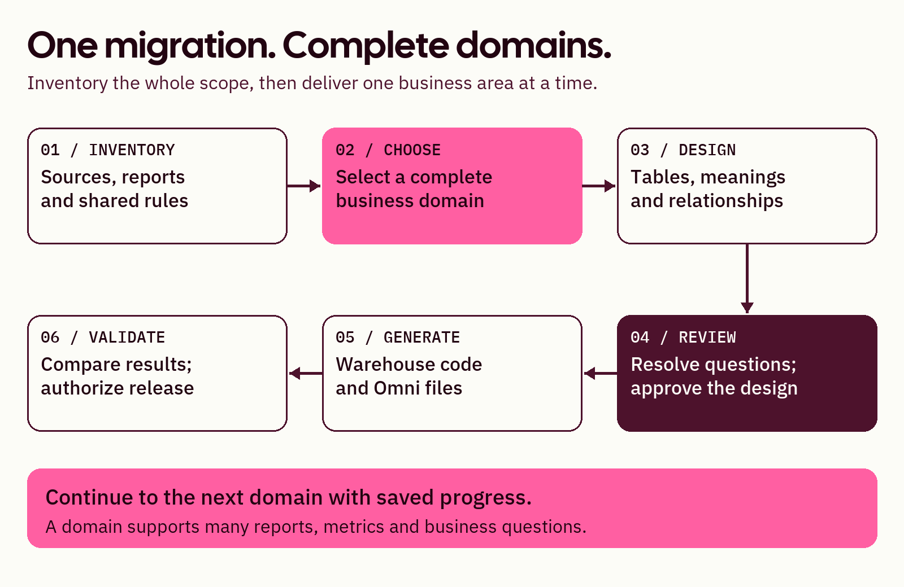

# 1. Understand the accelerator

[Learning path](README.md) · [Next: follow a migration](02-migration.md)

**Your goal: explain what the tool produces and where people make decisions.**

The Data Model Accelerator helps turn scattered reporting logic into a shared, documented data model: tables with clear meanings, keys and relationships. It supports migration planning, refactoring existing models, and designing new domains from raw data.

It runs through your team's AI coding assistant. The repository supplies skill instructions and supporting tools; it is not a separate website you sign into. Exact capabilities depend on the supplied inputs, the assistant's tools and the chosen destination.

## How the work moves

*Teaching illustration. A domain supports many reports, metrics and business questions.*

The **coordinator** organizes the engagement, asks missing questions and retains progress. **Specialists** interpret sources, design tables, prepare selected code and review evidence. They receive focused context. Some assistants use separate subagents; others perform disclosed sequential specialist tasks.

You do not need to manage those roles yourself. Your team provides business meaning, verifies data and authorizes releases. In a small company, one person may perform several responsibilities; technical validation still needs appropriate access and skills.

## What it helps you do

| Situation | Useful outcome |
| --- | --- |
| Reports repeat logic and disagree | Find shared rules, expose conflicts and propose reusable models. |
| Existing models need rebuilding | Design a better structure and explain what replaces or reuses old work. |
| Reporting is moving to Omni | Prepare warehouse models, Omni semantic files and migration mappings. |
| A business area has never been modeled | Propose a domain from source evidence and business definitions. |

## What you receive

Select the outputs you need: diagrams, a dictionary, layer documentation, warehouse code, Omni files, historical mappings, and optional migration plans or ticket templates. A guided `START_HERE.html` brings the selected deliverables together.

An Omni topic is a curated starting point for exploring related data. It is not a rebuilt dashboard. Dashboard migration continues through an installed Omni Artifact Accelerator or an explicit engineering handoff.

Current release: suitable for supervised pilots. Syntax checks and generated files do not prove business definitions, matching results or effective access controls. Provisional code remains available when requested, with unresolved assumptions visible.

## You're ready when

You can distinguish a model proposal, generated code and a validated result, and identify who will review business meaning and technical behavior.
