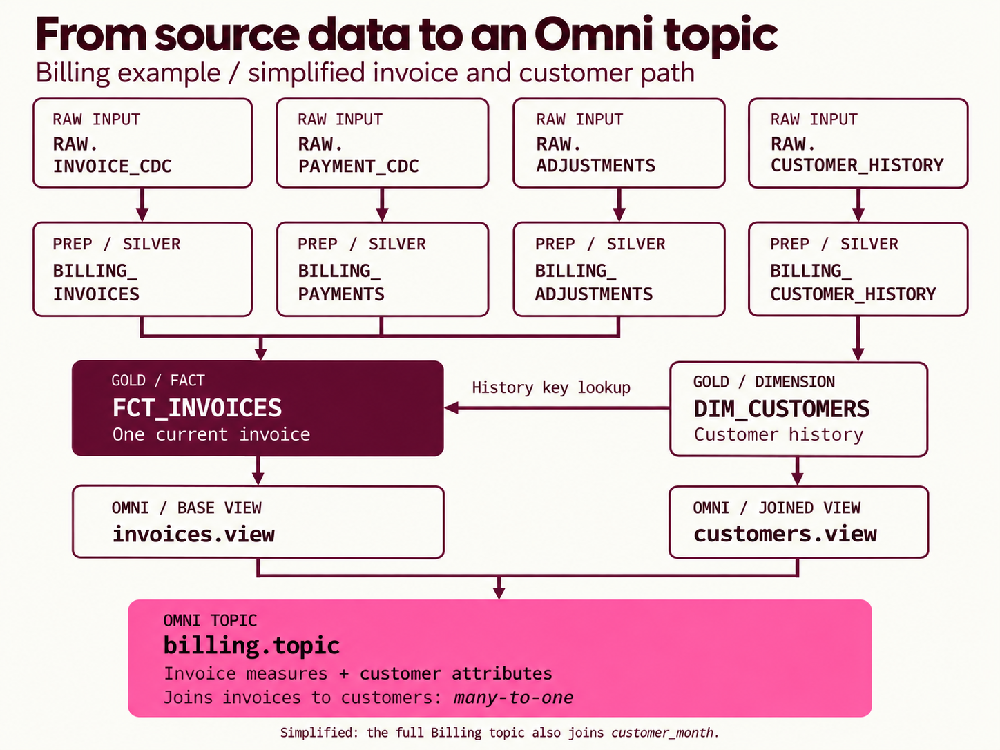

# 3. Explore a complete domain

[Learning path](README.md) · [Previous](02-migration.md) · [Next: review a delivery](04-review.md)

**Your goal: see how one domain supports several reports and definitions.**

The maintained Billing example contains four raw contracts, four preparation models and three gold models: **11 scoped warehouse objects**. It includes three Omni views, two topics and source-to-semantic mappings. These are synthetic candidates, not live deployment evidence.

## Follow warehouse models into an Omni topic

*Simplified teaching illustration based on the example files. The full Billing topic also joins `customer_month`; that branch is omitted here for clarity. Declared relationships still require data validation.*

Raw inputs become prepared data, then reusable gold tables. The fact uses customer history to resolve the invoice-date customer key. Each gold table binds to its own Omni view. **The topic brings the views together through a defined relationship**: invoice measures can be explored alongside customer attributes. It defines how to query the models; it does not create another warehouse table.

## Understand what one row means

| Gold model | Grain: what one row represents | Purpose |
| --- | --- | --- |
| `DIM_CUSTOMERS` | One customer history period within an organization | Retain classification at the relevant time |
| `FCT_INVOICES` | One current invoice within an organization | Combine invoice, payment and signed adjustment amounts |
| `FCT_CUSTOMER_MONTH` | One customer’s invoice activity per month and organization | Monthly activity and an approximate starting month |

The sample calls an organization a **tenant**: its records stay separate. If a customer changes segment in February, January invoices retain the January segment. The shared models support revenue, payment, balance, executive and retention-related reporting.

The example retains drafts in shared tables and applies posted-invoice restrictions in selected semantic measures. It keeps two active-customer meanings distinct. First-paid-month approximates a starting month from invoice months and current paid amounts; it does not record the first payment date.

## Follow the artifacts

Inspect these directly in GitHub without running code:

- [Layer documentation and dictionary](../../skills/data-model-accelerator/examples/hex-omni-e2e/documentation/README.md): fields, dependencies and open decisions.
- [Invoice model SQL](../../skills/data-model-accelerator/examples/hex-omni-e2e/target/dbt/models/gold/fct_invoices.sql): sums payments before joining invoices, with tenant-scoped identities.
- [Omni invoices view](../../skills/data-model-accelerator/examples/hex-omni-e2e/target/omni/invoices.view): physical binding, fields and measures.
- [Billing topic](../../skills/data-model-accelerator/examples/hex-omni-e2e/target/omni/billing.topic), [retention topic](../../skills/data-model-accelerator/examples/hex-omni-e2e/target/omni/retention.topic) and [relationships](../../skills/data-model-accelerator/examples/hex-omni-e2e/target/omni/relationships): related exploration paths.
- [Semantic mapping](../../skills/data-model-accelerator/examples/hex-omni-e2e/documentation/semantic-mapping.md): revenue, retention and executive source outputs mapped to definitions.

Find each file's role; you do not need to understand every line. Fixture names and rules are not defaults for your company. Retain your selected naming policy and reviewed definitions.

## Try one review decision

One report defines active customers by positive invoiced value; another uses positive payment value. Should the accelerator merge them automatically?

**Check your answer:** no. Retain clearly named alternatives and ask the business owner to resolve the disagreement. Code can remain provisional. Matching one report does not make its definition authoritative.

## You're ready when

You can explain how these models serve several reports, locate warehouse and Omni files, and identify a decision requiring review. Native dbt/Snowflake execution, Omni validation, dashboard behavior and effective access remain separate checks.
