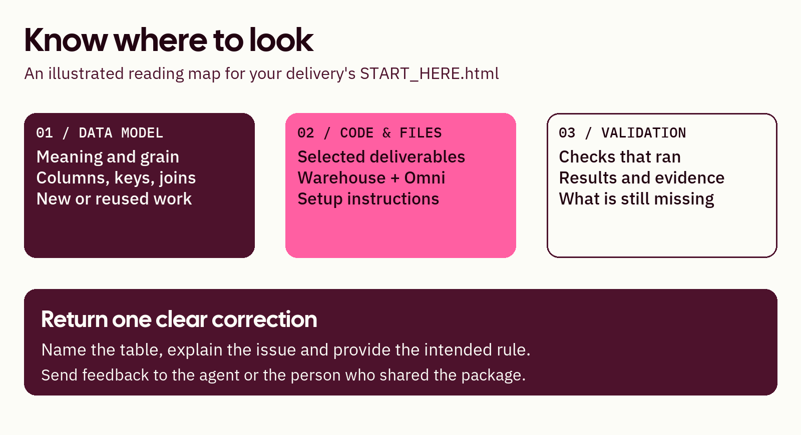

# 4. Review a delivery

[Learning path](README.md) · [Previous](03-domain.md) · [Next: install and verify](05-install.md)

**Your goal: find information and return a specific correction.**

Download and extract the delivery ZIP, then open `START_HERE.html` from the extracted folder. Keep the folders together. It works offline; GitHub's HTML preview does not run it. You do not need the accelerator installed to review a package.

## Visit these three areas

*Illustrated navigation map, not a screenshot. Controls vary with package layout, selected files and available evidence.*

1. **Data model:** in a simple package, choose a domain and gold output. Trace sources, then select a table for purpose, grain, columns, keys, new/reused status and linked code. A classic package uses the detailed ERD.
2. **Code & files:** find the selected narrative, implementation and engineering instructions. Reviewer packages exclude code; request an engineering package when needed.
3. **Validation:** inspect what actually ran, what was compared and what remains unverified. File integrity is not warehouse or business acceptance.

Inspect one table to learn the controls, then review the domain's full scope. Your starting table does not limit the model to one question. Display filters do not approve scope changes or shrink the full delivery.

## Find files without the page

| Default simple folder | Contents |
| --- | --- |
| `01_Input_Sources/` | Input references and explicitly included permitted files |
| `02_Input_Context_Files/` | Included business rules and context |
| `03_Design_Documents/` | Diagrams, dictionary, layer guidance and narrative |
| `04_Code_Generation/` | Selected code, setup guidance and validation files |
| `05_Mappings/` | Old-to-new comparisons and migration planning files |

Folder guides explain omissions. Original repositories are not automatically copied. Classic packages use `01_Model/`, `02_Implementation/` and `03_Validation/`; follow the package README.

## Return actionable feedback

Name the table, identify the issue and provide the rule or evidence needed. Example: “In Billing, retain invoice-date customer classification. Do not replace it with current classification. Show the affected models and reports.”

Reply in chat, or use **Prepare review feedback**, then **Download feedback**, then return that file to the agent. Send the downloaded feedback file—or your written comments—to the person who sent the package. The offline page does not submit feedback automatically.

## Know what you are approving

| State | Meaning |
| --- | --- |
| Draft or provisional | Reviewable output with unresolved assumptions or checks |
| Local checks passed | Stated local checks passed for identified files |
| Native validation recorded | Specified checks ran in the named warehouse or Omni environment |
| Business approval recorded | A person approved the exact definitions and scope |
| Deployment confirmed | An authorized deployment returned a confirmed result |

Answering a question is not automatically design approval. Design approval does not authorize deployment. Keep failures, unsupported behavior and missing evidence visible.

## You're ready when

You can find a definition, locate requested code or explain its absence, identify a missing check and return a correction. Optional: [practice with a small review package](practice.md).
