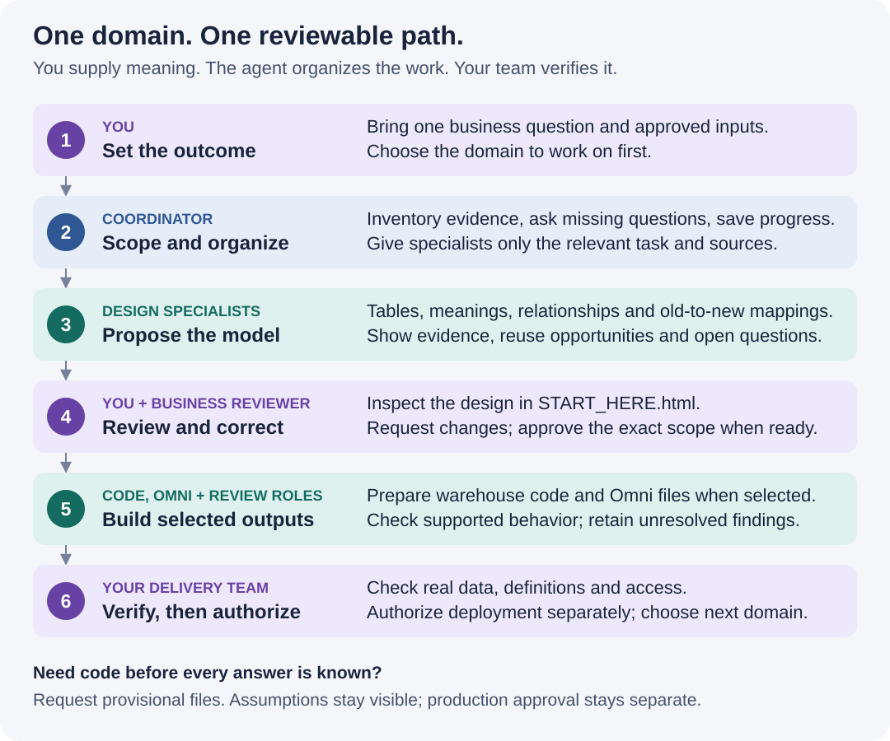

# Your first data model, step by step

**A self-guided introduction to the Data Model Accelerator. No coding knowledge required to review a design.**

The accelerator helps turn scattered reporting rules into a shared, documented data model: a set of tables with clear meanings and connections. You describe the outcome, the agent prepares a proposal, and your team checks it before using it.

| Start here if… | Your next step |
| --- | --- |
| You want to understand it before connecting anything | [Try the practice lesson](practice.md). It uses fictional commerce data and works as a reading exercise right here. |
| You have a real project and an approved AI coding assistant | [Start your first project](#start-your-first-project). Copy the prompt below. |
| Someone sent you a delivery ZIP | [Review a delivery](#review-a-delivery). You do not need the accelerator installed. |
| You are setting it up for a team | [Help your team adopt it](#help-your-team-adopt-it), then use the [engineering setup guide](../HOW_TO.md#1-make-the-skill-available-locally). |

## What it does

Imagine five reports defining “active customer” in five different ways. The accelerator finds the existing logic, shows the differences, and proposes reusable tables and definitions. Your business owner decides which meaning is right.

It runs **inside an AI coding assistant**, such as a configured Codex or Claude Code environment. This repository supplies the instructions and supporting tools. It is not a separate website you sign into. Your team's setup determines which files, connections and specialist agents are available.

| Your situation | How it helps | What you still contribute |
| --- | --- | --- |
| “Nobody knows what these reports are doing.” | Traces supplied code and documents sources, rules and unanswered questions. | Examples of trusted results and someone who can resolve business meaning. |
| “Our old models need rebuilding.” | Proposes shared models and explains what replaces, combines or retains old tables. | Identify the legacy repository and the future repository separately. |
| “We are moving reporting to Omni.” | Separates warehouse logic from reporting definitions; prepares selected Omni model files and migration mappings. | Select the dashboards in scope and check behavior and access. Topics alone do not rebuild dashboards. |
| “We have raw data but no model.” | Proposes tables, their purpose and their connections from available evidence. | Explain the questions the data should answer; unknown definitions remain open. |

Current release: **for supervised pilots**. A generated file or an attractive diagram is a proposal until the relevant technical checks and business review are complete.

## How people and agents work together



*Illustration of the workflow, not a screenshot. Read the same sequence below.*

1. **You choose a business area.** A *domain* is a related area such as sales, subscriptions or payments.
2. **The coordinator organizes the work.** It asks missing questions, retains decisions and tracks requested outputs.
3. **Specialists do focused tasks.** They interpret sources, design tables, write selected code, build the Omni model and review evidence. The host may run these as separate agents or as disclosed sequential tasks.
4. **You review and correct the proposal.** The coordinator updates the affected work instead of treating every correction as a new project.
5. **Your team validates and releases it.** Design approval, code generation and permission to deploy are separate decisions.

The coordinator supplies relevant evidence to each specialist. More agents, a confident answer or more review passes do not by themselves establish accuracy.

## Start your first project

### 1. Bring one question and the right inputs

Choose a question you can recognize and check, such as “How many customers renewed each month?” Start with its domain before expanding across the warehouse.

Bring what you have; say **unknown** for what you do not:

| Input | Plain-language example |
| --- | --- |
| Business question and reviewer | “Monthly renewals; our billing lead can review the definition.” |
| Source evidence | Approved repository files, report exports, existing SQL or documented spreadsheet rules. Exact formats vary; ask the agent what it can actually read. |
| Warehouse catalogue | A list of available tables, columns and types. Your engineer can provide this without exporting customer rows. |
| Existing definitions and known errors | “Exclude trial accounts. We are unsure how pauses should count.” |
| Destination and naming rules | The target repository and platform, if known; established table names or conventions. |
| Requested outputs | Design only, design plus code, or design plus code and Omni. Add migration mappings/plans if useful. |

An engineer or workspace administrator should confirm the skill is available and the AI environment is approved for the supplied information. **Keep passwords, tokens and sensitive customer records out of prompts and packages.** Ask for approved, sanitized evidence when needed. Installing the tool does not grant data access.

You can choose dbt, Coalesce or native warehouse code, separately from Snowflake, Databricks, BigQuery, Redshift, ClickHouse or MotherDuck. You do not need to know the answer yet. Have your engineer confirm the combination using the [platform matrix](../PLATFORM_MATRIX.md); not every combination or source format has the same coverage.

### 2. Copy this first-project prompt

Replace the bracketed text. If an answer is missing, write **unknown**. Paste this into your approved AI coding assistant, not into the generated review page.

```text
Use the Data Model Accelerator from this repository. Confirm which installation
and revision you are using and that its supporting files are available.

My business question is: [question].
My inputs are: [file paths or approved accessible locations].
This is: [a new model / a refactor / a migration / unknown].
Legacy repository, if any: [location or none].
Future repository and completed models to consider reusing: [location or unknown].
Preferred tools and warehouse: [choices or unknown].
Omni required: [yes / no / unknown].
Known business rules and errors: [rules or unknown].
People who can review definitions: [roles or unknown].
Save this engagement and its deliverables outside the input repositories at:
[new local folder, or ask me to choose].

Keep source repositories read-only. Ask only the missing intake questions.
Identify the domains, explain coverage gaps, and ask which domain I want first.
For that domain, create a table design, readable diagrams, data dictionary and
open decisions before code. Explain what is new, reused or replaced. Use report
inventories as requirements to satisfy, not as instructions to make one model
per report. Preserve agreed naming rules and flag conflicting definitions.
Ask which delivery formats I want. Give me one START_HERE.html review page and
one current delivery package. Do not deploy or retire anything.
```

**You should receive:** a confirmed scope, missing-input questions, domain choices and a saved location. After you choose a domain, expect its design and outstanding decisions. If discovery is incomplete, the agent should say which inputs remain unread or unresolved.

### 3. Answer questions in business language

You can answer in the same chat. You do not need to edit technical records.

| The agent asks… | A useful answer might be… |
| --- | --- |
| “What does one row represent?” | “One invoice, even when it has several line items.” |
| “Which customers count?” | “Exclude test accounts; include canceled customers in historical months.” |
| “Which total should agree?” | “The approved finance report for June, using its currency and date rules.” |
| “Who can see this?” | “Only finance can see customer-level amounts. Please confirm how that will be enforced.” |
| “Two reports disagree. Which wins?” | “Keep this open for our business owner; do not choose silently.” |

These are examples of answers, **not default business rules**. Include the decision or table name when correcting something. Ask the agent to repeat the interpretation and show which outputs change.

### 4. Review the design, then choose the next stage

Follow the [review checklist below](#review-a-delivery). Request corrections before approving. Once you agree with a particular design, identify it explicitly:

```text
I approve the displayed design for [domain and version]. Generate the selected
warehouse code and [Omni files, if selected] for that scope. Keep other domains
queued. Show remaining technical checks and business decisions. This approves
candidate generation only; it does not authorize warehouse execution or deployment.
```

If missing context prevents full approval but you want to inspect draft code:

```text
Generate provisional warehouse code and [Omni files, if selected] for [domain] from the evidence we
have. Mark assumptions, unresolved table/column bindings and unverified behavior.
Do not treat this request as design approval or deployment permission. Include
the actual requested files in the engineering package, not only design documents.
```

The provisional route lets work continue while making uncertainty visible. Your engineer must resolve relevant gaps before production use.

## Review a delivery

**Download the ZIP, extract it, then open `START_HERE.html` from the extracted folder.** It is designed to work offline. GitHub's file preview shows HTML source rather than running this review page. Keep the extracted folders together.

Read these three areas first. Controls vary with the included evidence, package size and layout.

| Area | Look for | Question to answer |
| --- | --- | --- |
| **Data model** | Tables, their purpose, columns, keys, connections and new/reused status. In simple packages, start with **Pipeline to one gold table**. | “Does this represent our business correctly, and can I trace where it comes from?” |
| **Code & files** | The design document, selected implementation files and setup guidance. | “Did we receive the outputs we requested?” A reviewer package intentionally omits code; ask for an engineering package to include it. |
| **Validation** | Checks performed, their scope, results and missing evidence. | “What was actually tested, against which version and environment?” |

For one important table, check:

- **Meaning:** Can you explain its purpose and what one row represents?
- **Coverage:** Are the expected sources and reports accounted for? Missing items must be visible, not guessed.
- **Connections:** Could matching several records multiply a total? Ask the engineer for evidence against double-counting.
- **Rules:** Are dates, exclusions, refunds, currencies and sensitive-field handling explicit where relevant?
- **Change:** What happens to the old table or dashboard? A mapping is a proposed destination, not proof of matching results.

Use domain and table filters to inspect a smaller view. **A display filter does not change project scope or the full package.** Ask the agent explicitly for a narrower delivery if that is what you need.

To send corrections, reply in the chat or use **Prepare review feedback → Download feedback**, then return the downloaded file to the agent. **If someone sent you the ZIP, send the feedback file or your written comments back to that person.** You do not need your own agent session. The offline page does not send it automatically. Request a refreshed package and retain the previous one for reference.

### Find the files without the page

New finalized deliveries use this simple layout. Only the selected, permitted content is included; folder guides explain gaps.

| Location | What belongs there |
| --- | --- |
| `START_HERE.html` | The guided review entrypoint. |
| `01_Input_Sources/` | References to inputs and explicitly included source files; not automatic repository copies. |
| `02_Input_Context_Files/` | Included business context and supporting input guidance. |
| `03_Design_Documents/` | Design narrative, diagrams and dictionary. |
| `04_Code_Generation/` | Selected code, setup guidance and validation files. |
| `05_Mappings/` | Included old-to-new comparisons and migration planning files. |

Older/classic packages, including the practice demo, use `01_Model/`, `02_Implementation/` and `03_Validation/`. Follow the package's own README. Keep the accelerator checkout, source repositories and private working evidence separate from the shareable delivery.

### Understand the status before approving

| Evidence you see | What it establishes | What it does not establish |
| --- | --- | --- |
| Draft / provisional | A candidate exists with known uncertainties. | Correct definitions or safe production use. |
| Package or local checks passed | Files or supported structures passed the stated checks. | Real warehouse results, effective access or business approval. |
| Native validation recorded | The recorded checks ran in the named target environment. | Every business rule or dashboard is correct. |
| Business review recorded | A person approved the identified scope and version. | Permission to deploy it. |
| Deployment confirmed | An authorized deployment has a confirmed result. | Permission to retire every old model or report. |

Ask for the next action and its owner when a status is unclear. The engineer checks execution and data accuracy; the business reviewer checks meaning and expected results; the release owner authorizes deployment.

## Continue without starting over

```text
Resume the saved engagement at [folder]. Keep our approved decisions, naming
rules and requested outputs. Show what changed, what can be reused, and what
needs another check. Work only on [domain or correction]. Do not rescan unrelated
sources or regenerate unchanged outputs. Tell me what is complete and what is pending.
```

Finish the selected domain's agreed work, then choose the next domain. Reuse and focused reviews reduce repeated work; actual usage and charges belong to your AI host. The accelerator's effort ratings describe implementation complexity, not a bill or a promised delivery time.

For an Omni migration, optionally request a dashboard handoff to an installed **Omni Artifact Accelerator** after topic work. For migration planning, request Excel/Word or Google Sheets/Docs and your ticket format. Native Google files require the host's connector and verification. Ticket templates do not create live tickets. Publishing, deployment and retirement require separate authorization.

## Help your team adopt it

1. **Choose one useful pilot.** Pick a domain with a recognizable business question and a result someone can check.
2. **Pair two roles.** A business reviewer supplies meaning; an engineer supplies approved access and technical validation. One person may cover both roles when qualified.
3. **Agree on the first output.** Begin with a reviewable design and one delivery location. Decide whether the next step includes code, Omni or migration planning.
4. **Hold one focused review.** Inspect a table, trace its sources, resolve a definition and check the old-to-new mapping if applicable.
5. **Expand when the evidence supports it.** Record what worked, remaining gaps and the next domain. A practice pass alone is not production acceptance.

You have completed this introduction when you can **start a scoped engagement, find a table's definition, return a correction, and distinguish draft files from verified results**. Try those actions in the [practice lesson](practice.md).

## When something is confusing

| Problem | What to ask |
| --- | --- |
| “I don't know the technical answers.” | “Keep them unknown and give me a short request I can send to our engineer. Continue the evidence-based design.” |
| “There is no Start Here page.” | “Finalize the current selected delivery with one START_HERE.html. If work is incomplete, label the checkpoint and list what is missing.” |
| “The package has no code.” | “Was code requested and generated, or excluded by the reviewer export? Produce the selected engineering package; keep unresolved code provisional.” |
| “The diagram seems incomplete.” | “Check the model inventory against the visible diagram, active filters and upstream dependencies. Identify missing or unbound objects.” |
| “It keeps asking the same questions.” | “Resume the existing engagement and reuse our recorded answers. Ask only about changed or unresolved decisions.” |
| “The topics exist, but my dashboard does not.” | “Show the selected migration scope. Prepare the dashboard continuation and list remaining behavior and access checks.” |

## A small glossary

| Term | Meaning |
| --- | --- |
| Data model | Tables with defined purposes, fields and connections. |
| Domain | A related business area, such as billing. |
| Grain | What one row represents. |
| Fact / dimension | An event or measurement table / a table describing things such as customers or products. |
| PK / FK | A primary key identifies a row; a foreign key refers to a related table. A diagram label is a declaration, not proof of uniqueness or enforcement. |
| Lineage / ERD | Where data comes from and how it is transformed / how tables relate. These answer different questions. |
| Raw, staging, intermediate, gold | Original inputs, prepared inputs, shared transformations and analysis-ready outputs. Your governed names may differ. |
| Semantic layer / Omni topic | Reporting definitions over warehouse data / a curated starting point for exploring related data in Omni. |
| Catalogue / dictionary | What tables and columns exist / what the modeled tables and columns mean. |
| Provisional | Usable for review, with unresolved assumptions or checks. |

[Practice lesson](practice.md) · [Engineering how-to](../HOW_TO.md) · [Capabilities and limits](../CAPABILITIES.md) · [Back to the repository](../../README.md)
